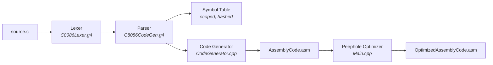

# C → Intel 8086 Assembly Compiler

A compiler for a substantial subset of C that emits runnable **Intel 8086 assembly**, written in
C++17 with **ANTLR 4** as the parser generator. It takes a `.c` source file and produces MASM/TASM
assembly that runs unmodified in the [emu8086](https://emu8086-microprocessor-emulator.en.softonic.com/)
emulator, along with lexer, parser and error logs.

Built as the term project for **CSE 310 – Compiler Sessional**, BUET, across four assignments that
each contributed one stage of the pipeline.

---

## Pipeline



Code generation is **single pass and syntax directed** — there is no separate IR. Semantic actions
embedded in the parser grammar fire as the parse tree is built, and each one appends 8086
instructions to the data or code section. Expression evaluation uses an explicit **stack machine**
discipline: every sub-expression leaves its result on the 8086 hardware stack, and each operator
pops its operands into registers, computes, and pushes the result back.

---

## Features

**Language subset**

| Area | Supported |
|---|---|
| Types | `int`, `void` (`float` is parsed and coerced to integer arithmetic) |
| Variables | Global and local declarations, multiple declarators per statement |
| Arrays | One-dimensional, global and local, with computed index expressions |
| Functions | Declaration, definition, parameters, **recursion**, return values |
| Arithmetic | `+` `-` `*` `/` `%` with correct `DIV`/`MUL`/`XOR DX,DX` sequences |
| Relational | `<` `<=` `>` `>=` `==` `!=` |
| Logical | `&&` `||` `!` |
| Unary | unary `-`, unary `+`, `!` |
| Inc/Dec | `++` and `--`, prefix and postfix, on scalars and array elements |
| Control flow | `if`, `if`/`else`, `while`, `for` — arbitrarily nested |
| I/O | `println(id)` builtin, backed by a generated `print_output` / `new_line` routine |
| Comments | `//` line and `/* */` block, logged then skipped |

**Compiler engineering**

- **Scoped symbol table** — a stack of hash-backed scope tables with SDBM hashing and separate
  chaining. Every insertion, lookup, scope entry and scope exit is dumped to the parser log, so the
  full symbol table history of a compilation is auditable.
- **Stack frame management** — locals are allocated at `[BP-n]`, parameters resolved to `[BP+n]`
  with correct reverse-order offsets, callee-cleanup via `RET n`, and a dedicated `RETURN_<func>`
  epilogue label so multiple `return` statements converge on one exit path.
- **Peephole optimizer** — a post-pass over the emitted assembly (see below).
- **Diagnostics** — separate lexer log, parser log and error log, each entry tagged with the source
  line number. Emitted instructions carry `; line N` comments back to the original C source.

---

## Peephole optimizer

`Main.cpp` re-reads the generated assembly and applies four pattern-based transformations, reporting
what it removed and the net line count saved:

| # | Pattern | Action |
|---|---|---|
| 1 | `MOV A, B` followed by `MOV B, A` | drop the second — the value is already in place |
| 2 | `PUSH R` immediately followed by `POP R` | drop both — a no-op round trip |
| 3 | `ADD r, 0` / `SUB r, 0` / `MUL` by 1 | drop — identity operations |
| 4 | Consecutive labels with no instruction between | collapse to the first |

Optimization 2 matters most here: the stack-machine code generator naturally emits `PUSH AX` / `POP
AX` pairs at every expression boundary, and this pass cleans them up.

Both the unoptimized and optimized assembly are kept, so the two can be diffed.

---

## Generated program shape

Every compilation produces a complete, assemblable program:

```asm
.MODEL SMALL
.STACK 1000H
.DATA
	number DB "00000$"          ; scratch buffer used by print_output
	<global variables>  DW 1 DUP (0000H)
.CODE
main PROC
	MOV AX, @DATA               ; only in main
	MOV DS, AX
	PUSH BP                     ; standard frame prologue
	MOV BP, SP
	...
RETURN_main:                    ; single exit point per function
	MOV AX, 4CH                 ; DOS terminate
	INT 21H
main ENDP

; print_output / new_line are appended only if println() was used

; Footer
END main
```

Non-`main` functions get the symmetric epilogue — `ADD SP, <locals>`, `POP BP`, then `RET` or
`RET <paramBytes>` when the function takes parameters.

---

## Repository layout

```
.
├── src/                        the compiler
│   ├── C8086Lexer.g4           lexer grammar — tokens + lexeme logging
│   ├── C8086CodeGen.g4         parser grammar with embedded codegen actions
│   ├── CodeGenerator.hpp/.cpp  the 8086 emitter and stack-frame bookkeeping
│   ├── Main.cpp                driver, file plumbing, peephole optimizer
│   └── symbol-table/           scoped symbol table
│       ├── SymbolInfo.hpp      one symbol: type, stack offset, params, array flag
│       ├── Hash.hpp            SDBM / DJB2 / FNV-1a hash functions
│       ├── ScopeTable.hpp      a single hash-backed scope
│       └── SymbolTable.hpp     the stack of scopes
├── scripts/
│   ├── setup-antlr.sh          one-time ANTLR tool + C++ runtime install
│   ├── build.sh                generate, compile, link
│   ├── run.sh                  compile one .c file
│   └── clean.sh
├── tests/                      sample C programs + expected program output
├── docs/                       assignment specs, grammar reference, runtime routines
├── phases/                     earlier assignment stages, kept for history
├── Makefile
└── README.md
```

### `phases/` — how this was built

The compiler was developed in four assignments. `src/` is the final stage; the earlier stages are
preserved here because each is a standalone, working program in its own right:

| Phase | Contents | Notes |
|---|---|---|
| `1-symbol-table` | Hash table, scope table, symbol table, driver | Pure C++, no dependencies. Supports pluggable hash functions and collision reporting. |
| `2-lexical-analyzer` | `2105057.l` (Flex) | A standalone lexer for the same C subset, emitting a token stream and symbol table log. |
| `3-syntax-semantic-analyzer` | ANTLR lexer + parser grammars, `Ctester.cpp` | Adds **semantic analysis**: type checking, multiple-declaration detection, parameter mismatch, return type mismatch, undeclared identifier reporting, and syntax error recovery. |

Phase 4 (code generation) carries the symbol table forward from phase 1 and the grammar from phase 3,
and is what lives in `src/`.

---

## Building

The compiler targets **Linux or WSL**. It needs the ANTLR 4.13.2 tool jar (Java) and the ANTLR C++
runtime.

```bash
# one-time: installs the ANTLR jar and builds the C++ runtime (needs sudo)
./scripts/setup-antlr.sh

# build
./scripts/build.sh          # or: make
```

If ANTLR is installed somewhere non-standard, override the paths:

```bash
ANTLR_JAR=/opt/antlr-4.13.2-complete.jar \
ANTLR_INCLUDE=/opt/antlr4-runtime \
ANTLR_LIB=/opt/lib \
./scripts/build.sh
```

The build writes ANTLR-generated sources to `build/generated/`, objects to `build/obj/`, and the
compiler binary to `build/c8086cc`. Nothing is generated into `src/`.

## Running

```bash
./scripts/run.sh tests/test5_i.c      # or: make run FILE=tests/test5_i.c
```

Artifacts land in `output/`:

| File | Contents |
|---|---|
| `AssemblyCode.asm` | generated 8086 assembly |
| `OptimizedAssemblyCode.asm` | after the peephole pass |
| `lexerLog.txt` | every token with its lexeme and line number |
| `parserLog.txt` | grammar rules matched, plus a symbol table dump at each change |
| `errorLog.txt` | syntax and semantic errors |

To actually execute the result, open `output/OptimizedAssemblyCode.asm` in **emu8086** and run it.

## Tests

`tests/` holds the sample programs; `tests/expected-output.txt` records what each should print when
the generated assembly is executed.

```c
// tests/test5_i.c — exercises functions, recursion-free calls, while, for, if/else
int f(int a){
	int k;
	k = 5;
	while(k>0){ a++; k--; }
	return 3*a - 7;
}

int g(int a, int b){
	int x,i;
	x=f(a)+a+b;
	for(i=0;i<7;i++){
		if(i%3 == 0){ x = x+5; }
		else        { x = x-1; }
	}
	return x;
}

int main(){
	int a,b,i;
	a=1; b=2;
	a=g(a,b);
	println(a);          // 25
	...
}
```

`tests/bonustest1_i.c` and `bonustest2_i.c` are the recursion cases — doubly-recursive functions
that exercise the call/return protocol and frame teardown.

---

## Known limitations

- `float` is tokenized and accepted, but all arithmetic is 16-bit integer; float constants are
  truncated.
- `switch` / `case` / `break` / `continue` have lexer tokens but no parser rules, so they are not
  compiled.
- No pointers, structs, unions, strings, or multi-dimensional arrays.
- Arrays are indexed without bounds checking.
- `getVariableAddress()` writes `DEBUG:` lines to stderr on every variable access; harmless, but
  redirect stderr for quiet runs.

---

## Credits

Coursework for **CSE 310 – Compiler Sessional**, Department of CSE, BUET.
Assignment specifications and the reference grammar are in [`docs/`](docs/).
The `print_output` / `new_line` output routine ([`docs/runtime-routines.asm`](docs/runtime-routines.asm))
was supplied with the assignment and is embedded into every generated program.
